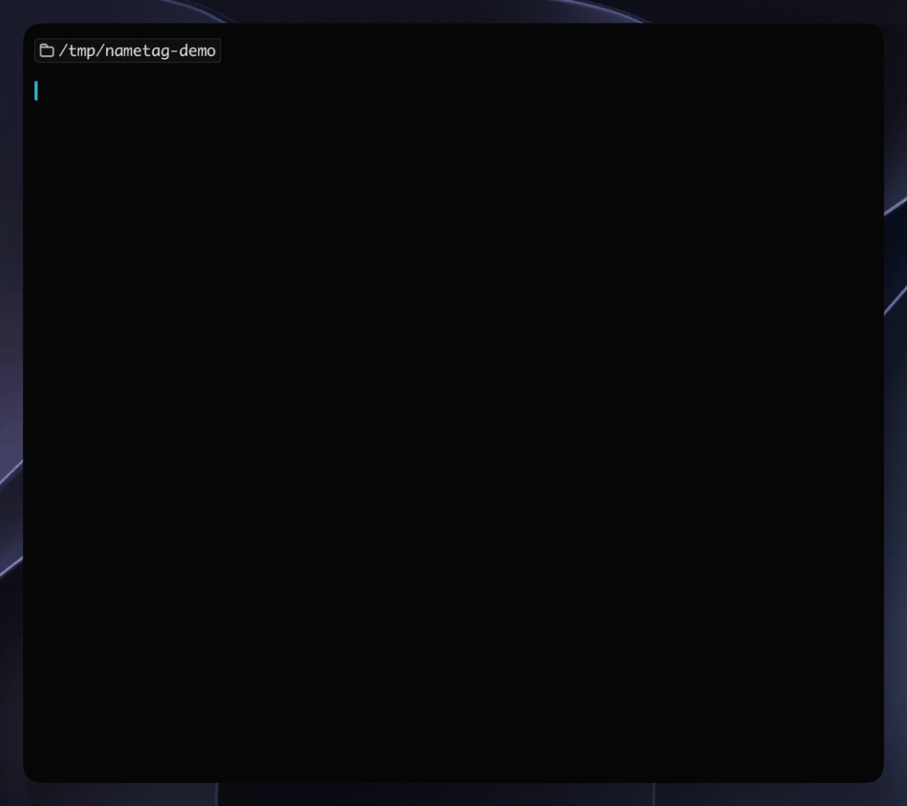

# nametag

セッションに色と名前を自動で付ける mod です。どのタブが何の作業かを見分けられます。



## 機能

セッションごとに、プロンプトバーの色と名前を自動で付けます。名前は、最初の返答が終わったところで会話の中身から付けます。

- リンクだけを渡しても、取ってきた中身で命名
- 使う人が書いている言語で命名（組み込みの `/rename` は英語のハイフン区切り）
- `/nametag` で今の話題に付け直し
- 手で付けた名前は変更しない
- 色の変更はターミナルのみ

## インストール

### Claude Code

```text
/plugin install nametag --marketplace miiiiiiich/agent-mods
```

### シェル

```bash
claude plugin install nametag --marketplace miiiiiiich/agent-mods
```

### デスクトップアプリ

入力欄の横の + → Plugins → Add marketplace に `miiiiiiich/agent-mods` → Add plugin で nametag を選びます。

## 使い方

入れるだけで動きます。

| いつ | 色 | 名前 |
|---|---|---|
| 新しく起動した | 付けます | なし |
| 名前がないまま送信して、返答が終わった | そのまま | 会話から付けます。リンクを渡したときは、取ってきた中身で付きます |
| `/clear` した | 付け直します | 自動の名前は次の返答の終わりに付け直します。手書きは残します |
| 再開した | そのまま | そのまま |

### `/nametag`

今の会話から名前を付け直します。途中で話題が変わったときに打ちます。

- 作業中に打つと、名前は作業が終わってから変わります。
- 付けた名前は自動の名前として扱います。`/clear` のあと、次の返答の終わりに付け直します。

## 設定

`/config` の **Naming rules** で、名前の付け方を変えられます。言語、長さ、書き方を文章で指定します。自動の名前にも `/nametag` にも使われます。変えるとすぐ反映されます。

既定は `plugin.json` の `default` にあります。使う人が書いている言語で、短い名詞句の名前にする内容になっています。

変えられるのはこの部分だけで、「1 行で名前だけを返す」「分からなければ SKIP」は mod が固定しています。空にすると、固定の部分だけで名前を聞きます。

## 仕組み

- 名前は今のセッションのモデルに聞きます。直前にモデルへ送った内容（会話、システムプロンプト、ツールの定義）を送り直し、ほかの宛先には送りません。会話のキャッシュを使うので速いですが、会話が長いほどキャッシュの読み込みは増えます。
- 実行するコマンドは引数なしの `/color` と、名前を付けるときの `/rename 名前` だけです。
- `/rename` はセッションの作業が終わるのを待って動きます。そのため、返答が終わってすぐ次を送ると、名前はその次の返答が終わってから付きます。
- 返答の途中で自分で名前を付けると、そちらが残ります。自動の名前が `/rename` を待っている間に付けたときは、自動の名前がいったん付いたあと、mod が手で付けた名前に戻します。

## 名前が付かないとき

以下のときは、次に送ったプロンプトの返答が終わったときに、また聞きます。

- 何の作業か読み取れない（挨拶、「続けて」など）
- モデルへの問い合わせが失敗した

返答を途中で止めたときと、エラーで終わったときは、その場では聞かず、次に返答が終わったときに聞きます。

スケジュール実行、通知、`-p` のプロンプトでは名前を付けません。

## 制限

- 再開したセッションと、mod を読み込み直したセッションでは、自動の名前と手書きの名前を区別できません。どちらも手書きとして扱い、`/clear` でも変えません。
- 色は8色なので、セッションを同時にいくつも開くと被ることがあります。
