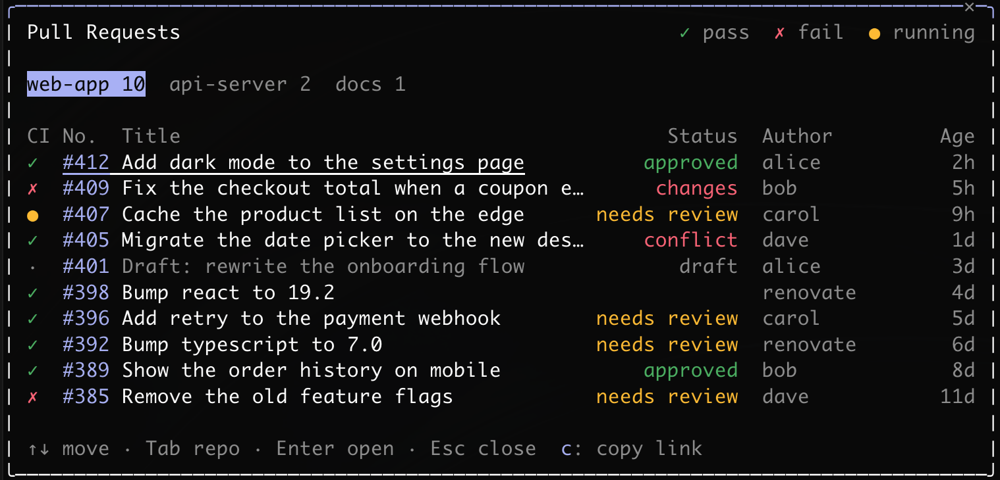

# pn

キーボードで操作するペインをまとめた mod です。今あるのは `/pn:pr` で、開いている PR の一覧をペインに出します。



## 機能

Claude Code 上でプルリクエストを確認し、リンクをコピーしたり、ブラウザで開いたりできます。

- 起動したフォルダから 3 階層下までの GitHub リポをまとめて表示
- CI、番号、タイトル、状態、作成者、経過時間を一覧で表示
- キーボードだけで操作
- ターミナルとデスクトップアプリに対応

## インストール

必要なもの: [`gh`](https://cli.github.com/) コマンド（ログインしたもの）

### Claude Code

```text
/plugin install pn --marketplace miiiiiiich/agent-mods
```

### シェル

```bash
claude plugin install pn --marketplace miiiiiiich/agent-mods
```

### デスクトップアプリ

入力欄の横の + → Plugins → Add marketplace に `miiiiiiich/agent-mods` → Add plugin で pn を選びます。

## 使い方

`/pn:pr` を打つと、ペインが開きます。

| キー | 動き |
|---|---|
| `↑` `↓` | PR を移ります。端まで行くと反対の端に回ります |
| `Tab` / `Shift+Tab` | リポを移ります |
| `Enter` | 下線の PR をブラウザで開きます |
| `c` | 下線の PR のリンクをコピーします |
| `Esc` | 閉じます |

`←` `→` は mod に届かないので使えません。

ターミナルでは、マウスでリポの切り替えとホイールが使えます。行はボタンではないので、クリックでは開きません。デスクトップアプリでは行がボタンで、クリックで開きます。キーの操作とリンクのコピーはターミナルだけです。

### 一覧の見方

- CI: `✓` 成功、`✗` 失敗、`●` 実行中、`·` チェックなし
- 状態: `draft`、`conflict`、`changes`（修正依頼）、`approved`、`needs review`（必須のレビューが未承認）

### ペイン

- ターミナルでは、文字を打つ、ペインの外をクリックする、プロンプトを送る、のどれかで閉じます。アプリでは、プロンプトを送ると閉じます
- 高さは `Ctrl+X` のあとに矢印で変えられます。変えた高さは、ほかの mod のペインにも使われます

## 仕組み

- `find` で、起動したフォルダから 3 階層下までの `.git` を探します（symlink もたどります）。隠しフォルダと `node_modules` の中は探しません。15 秒で終わらないときは、探すのをやめてそう表示します
- `git` でリモートを調べ、GitHub のリポだけを見ます
- `gh api graphql` で PR を取得します。ペインを開くたびに 1 回取得し、開いている間は更新しません
- `gh pr view --web` でブラウザを開きます。開くのは `https://github.com/` の URL だけです
